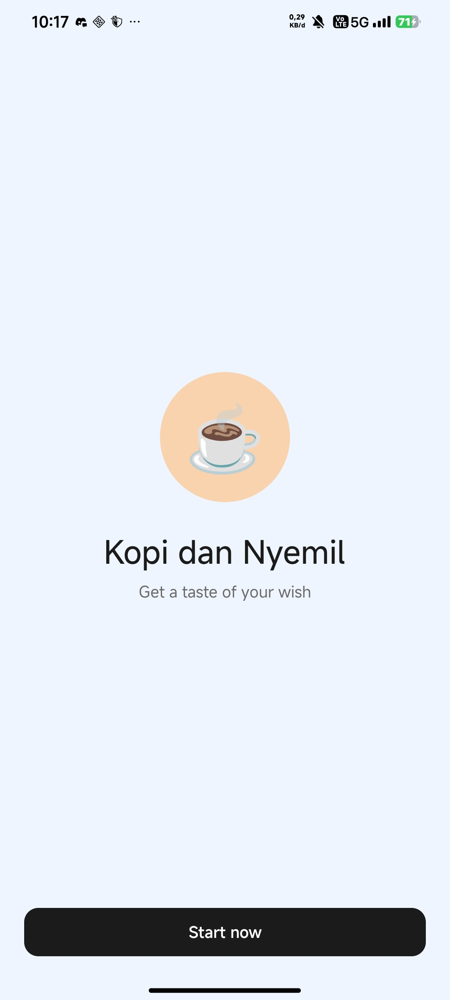
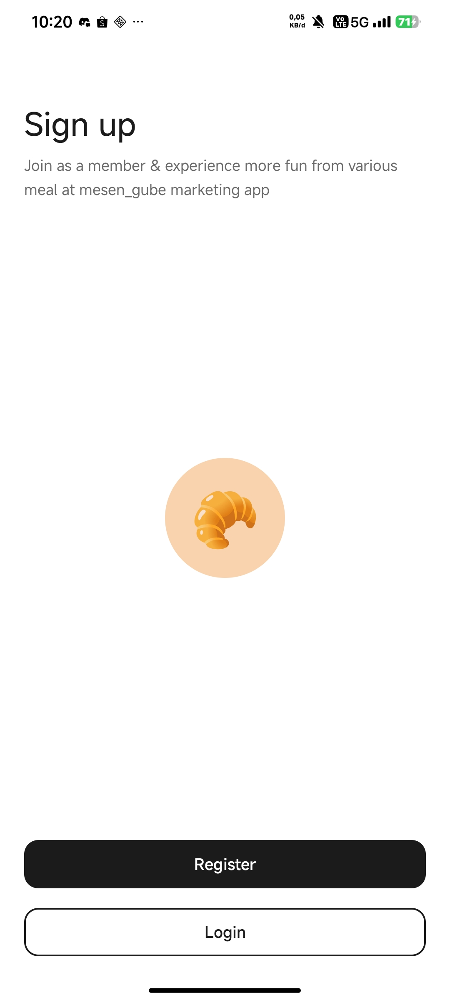
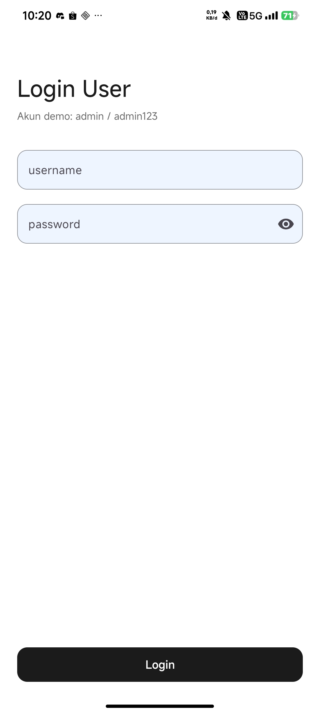
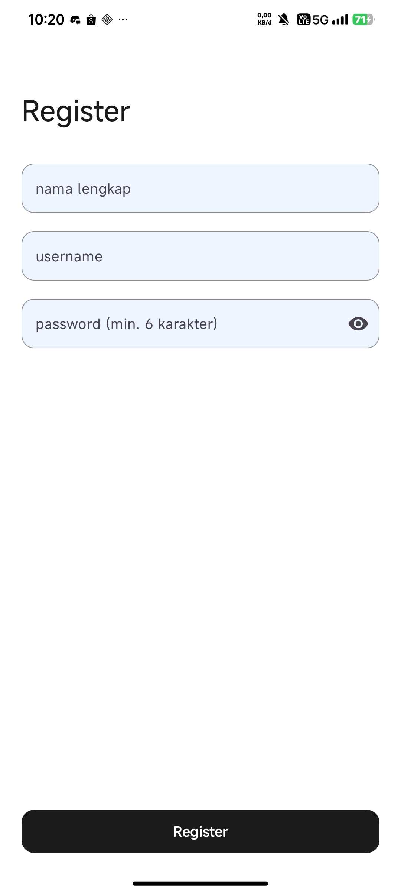
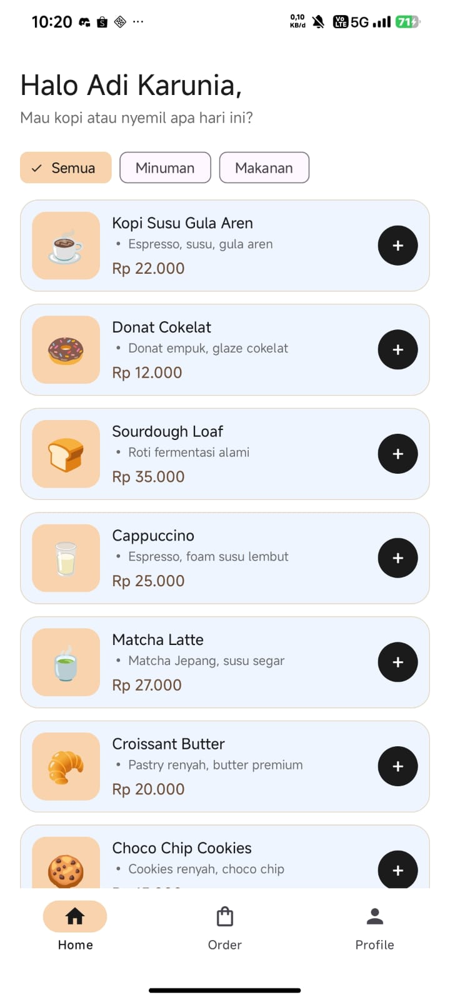
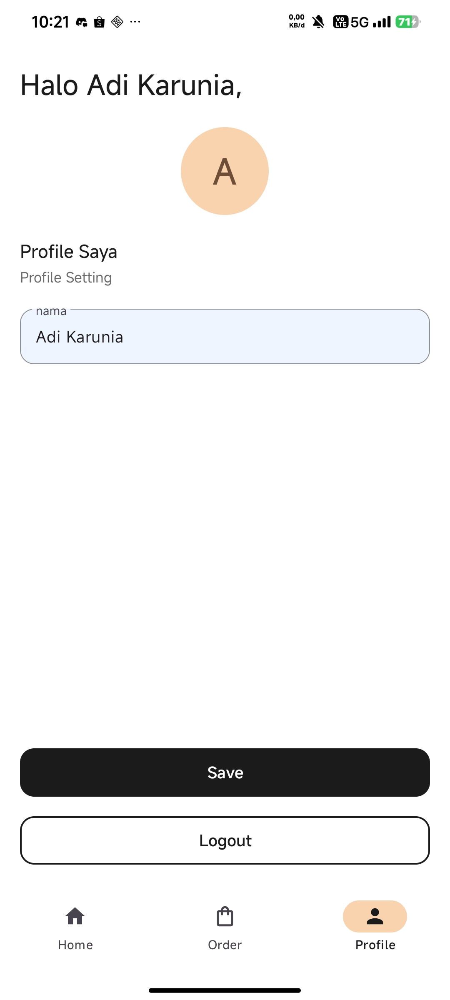
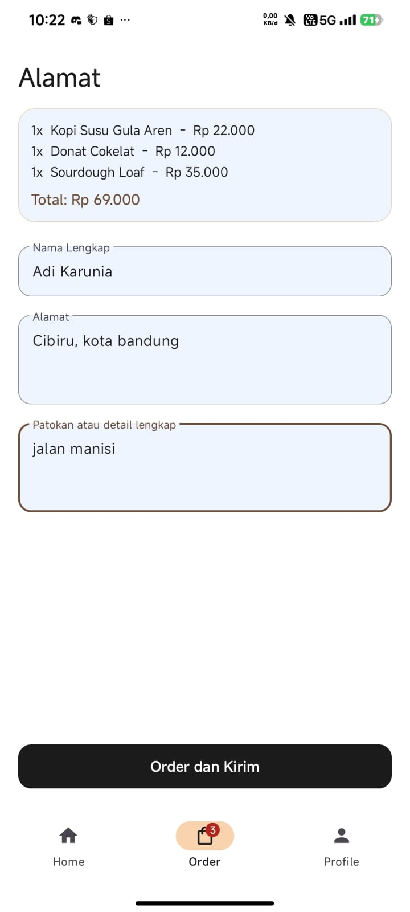
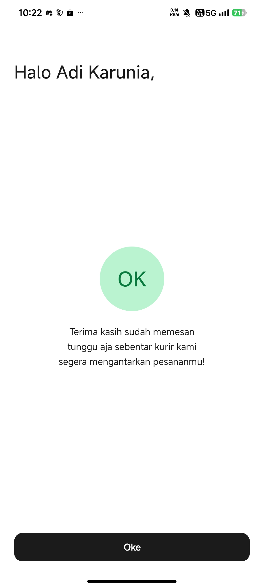

# ☕ Kopi dan Nyemil

Aplikasi mobile pemesanan kopi dan camilan berbasis **Android (Kotlin + XML Views)**, dibuat untuk tugas mata kuliah **Pemrograman Mobile**. Tampilan dan alur mengikuti wireframe "Kopi dan Nyemil", lalu dikembangkan dengan tema warna cokelat-krem yang hangat dan komponen Material Design.

## Deskripsi

Pengguna membuka aplikasi, mendaftar atau login, memilih menu makanan dan minuman, mengisi alamat pengiriman, lalu menerima konfirmasi pesanan. Aplikasi **tidak menggunakan database**: seluruh data (daftar menu, akun pengguna, dan keranjang) disimpan sebagai data statis (dummy) di memori, sehingga akan kembali ke kondisi awal setiap aplikasi ditutup total.

## Fitur

| No | Halaman | Fitur |
|----|---------|-------|
| 1 | Splash / Welcome | Logo, nama aplikasi, tagline, tombol **Start now** |
| 2 | Sign up | Pilihan **Register** atau **Login** |
| 3 | Login User | Form username & password, validasi akun, pesan error |
| 4 | Register | Form nama lengkap, username, password (min. 6 karakter), cek username ganda |
| 5 | Home | Daftar **7 menu** makanan/minuman (RecyclerView), filter kategori, tombol tambah/kurang jumlah |
| 6 | Profile | Ubah nama dan simpan, tombol Logout |
| 7 | Alamat pengiriman (Order) | Ringkasan pesanan + total harga, form nama, alamat, patokan, tombol **Order dan Kirim** |
| 8 | Konfirmasi pesanan | Pesan terima kasih dan tombol **Oke** kembali ke Home |

Fitur tambahan di luar wireframe:
- Bottom navigation (Home, Order, Profile) dengan **badge** jumlah item di keranjang.
- Keranjang pesanan sederhana sehingga halaman Order menampilkan ringkasan dan total.
- Validasi form dengan pesan error pada setiap field.

**Akun demo:** username `admin` / password `admin123`

## Teknologi yang Digunakan

- Bahasa: **Kotlin**
- UI: **XML Layout (Views)**, Material Components (Material 3)
- Komponen: `RecyclerView`, `BottomNavigationView`, `Fragment`, `ChipGroup`, `TextInputLayout`, `MaterialButton`
- Data: data statis (dummy) di memori, tanpa database
- IDE: Android Studio
- Minimum SDK: API 27 (Android 8.1)

## Struktur Proyek

```
app/src/main/
├── java/lat/pam/kopidannyemil/
│   ├── MainActivity.kt          # Splash / Welcome
│   ├── SignUpActivity.kt        # Sign up
│   ├── LoginActivity.kt         # Login User
│   ├── RegisterActivity.kt      # Register
│   ├── HomeActivity.kt          # Wadah + bottom navigation
│   ├── HomeFragment.kt          # Daftar menu
│   ├── MenuAdapter.kt           # Adapter RecyclerView
│   ├── OrderFragment.kt         # Alamat pengiriman
│   ├── ProfileFragment.kt       # Profile
│   ├── ConfirmationActivity.kt  # Konfirmasi pesanan
│   └── DummyData.kt             # Data menu, user, dan keranjang
└── res/
    ├── layout/                  # activity_*.xml, fragment_*.xml, item_menu.xml
    ├── drawable/                # bentuk lingkaran, kartu, ikon
    ├── menu/bottom_nav_menu.xml
    └── values/                  # colors, strings, themes
```

## Cara Menjalankan

Prasyarat: [Android Studio](https://developer.android.com/studio) versi terbaru dan emulator atau perangkat Android (API 27+).

1. Clone repository ini:
   ```bash
   git clone https://github.com/Adi78137/KopiDanNyemil.git
   ```
2. Buka Android Studio, pilih **File > Open**, lalu pilih folder `KopiDanNyemil`.
3. Tunggu proses **Gradle Sync** sampai selesai.
4. Pilih emulator atau hubungkan perangkat Android.
5. Klik tombol **Run ▶** (atau tekan `Shift + F10`).
6. Login dengan akun demo `admin` / `admin123`, atau daftar akun baru lewat halaman Register.

## Alur Aplikasi

```
Splash → Sign up → Login / Register → Home ⇄ Profile
                                        ↓
                                      Order (Alamat) → Konfirmasi → Home
```

## Screenshot

| Splash | Sign up | Login | Register |
|:--:|:--:|:--:|:--:|
|  |  |  |  |

| Home | Profile | Alamat (Order) | Konfirmasi |
|:--:|:--:|:--:|:--:|
|  |  |  |  |

## Identitas

- Nama: Adi Karunia
- NIM: 1247050127
- Mata kuliah: Pengembangan Aplikasi Mobile
